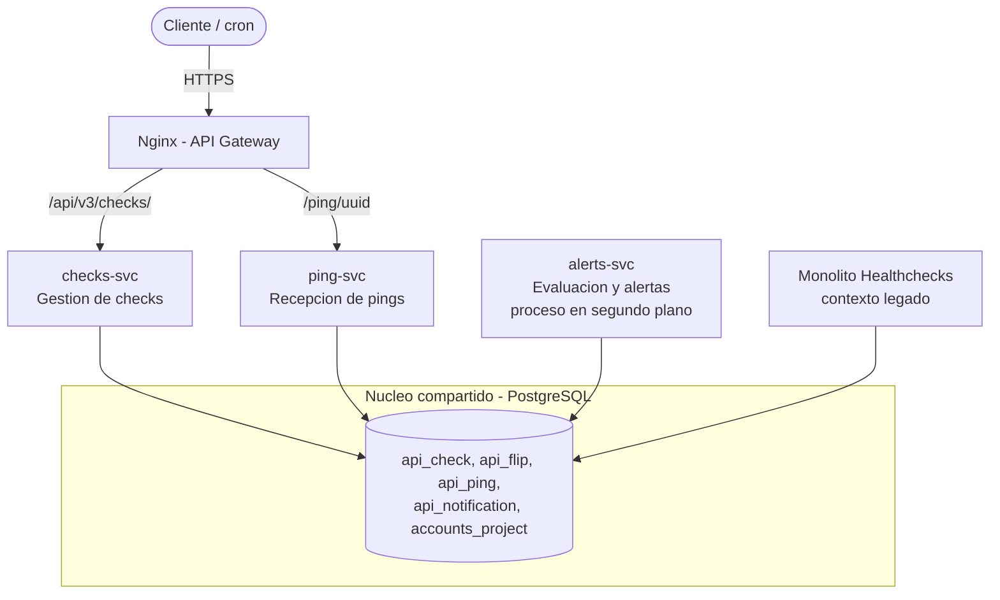

# Bloque I – A1: Análisis del Monolito y Mapa de Contextos

## 1. Funcionalidades extraídas

Del monolito Healthchecks se extraen tres funcionalidades a microservicios, manteniendo el monolito intacto (patrón Strangler Fig):

- **checks-svc** (Jazmín): API de gestión de checks — `/api/v3/checks/`.
- **ping-svc** (Sonia): recepción de pings — `/ping/<uuid>`.
- **alerts-svc** (Diego): evaluación de estados y envío de alertas — proceso en segundo plano (`sendalerts`).

## 2. F5-E1: Tablas verificadas en la base real

Consulta ejecutada sobre `information_schema` en la VM (PostgreSQL 18.6, base `hc`):

```sql
SELECT table_name
FROM information_schema.tables
WHERE table_schema = current_schema
ORDER BY table_name;
```

**Resultado: 23 tablas.** Las que intervienen en la migración son las de los grupos `api_*` y `accounts_*`. Las demás (`auth_*`, `django_*`, `api_tokenbucket`, `logs_record`, `payments_subscription`) corresponden a funcionalidades del monolito que no se extraen en esta fase.


## 3. F5-E2: Matriz de acoplamiento (tabla × servicio)

| Tabla | checks-svc | ping-svc | alerts-svc | ¿Compartida? |
|-------|:---------:|:--------:|:---------:|-------------|
| api_check | CRUD | Actualiza estado | Lee estado | Sí — los tres |
| api_flip | Borra (hijo) | Inserta | Lee / marca procesado | Sí — los tres |
| api_ping | Borra (hijo) | Inserta | — | Sí — checks + ping |
| api_channel_checks | Borra (hijo) | — | Lee | Sí — checks + alerts |
| api_notification | Borra (hijo) | — | Inserta | Sí — checks + alerts |
| api_channel | — | — | Lee | No |
| accounts_project | Lee (auth por API key) | — | — | Global (cuentas) |
| accounts_profile | — | Lee (límite de pings) | — | Global (cuentas) |

**Interpretación:** `api_check` y `api_flip` son las tablas más acopladas, porque las tocan los tres servicios. Ese acoplamiento es la razón por la que no se puede hacer "una base por servicio" de forma directa, y es lo que justifica la decisión de usar una base compartida (ADR-009). El "Borra (hijo)" de checks-svc indica que, al eliminar un check, primero borra sus filas dependientes en las otras tablas dentro de una misma transacción.

## 4. F5-E3: Mapa de contextos (DDD)



El patrón DDD que aplica es **Núcleo Compartido (Shared Kernel)**: los tres contextos comparten el esquema de la base. ping-svc produce los cambios de estado (flips) y alerts-svc los consume, así que entre ellos hay una relación proveedor/cliente a través de la base.
