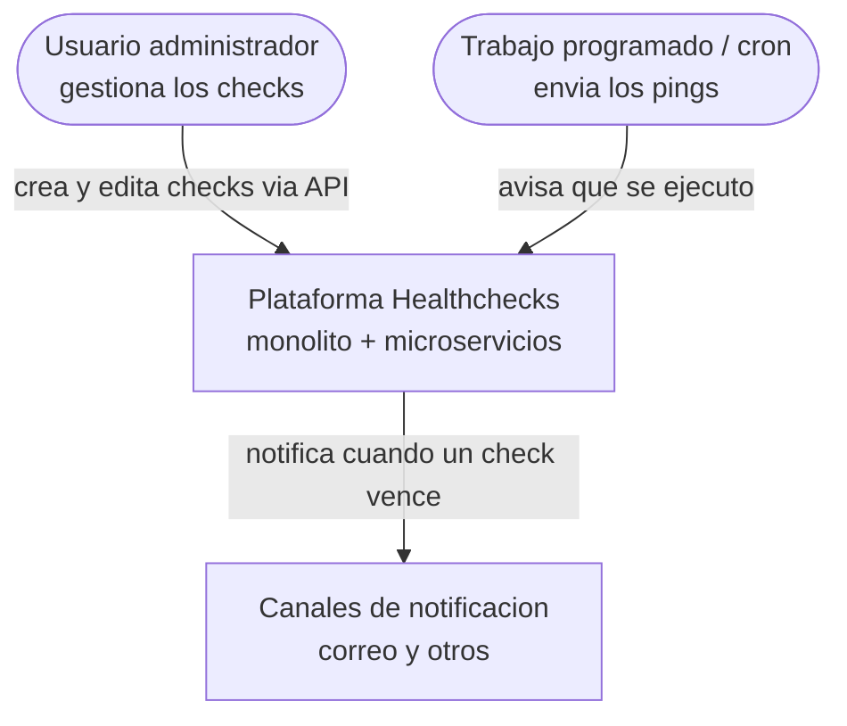
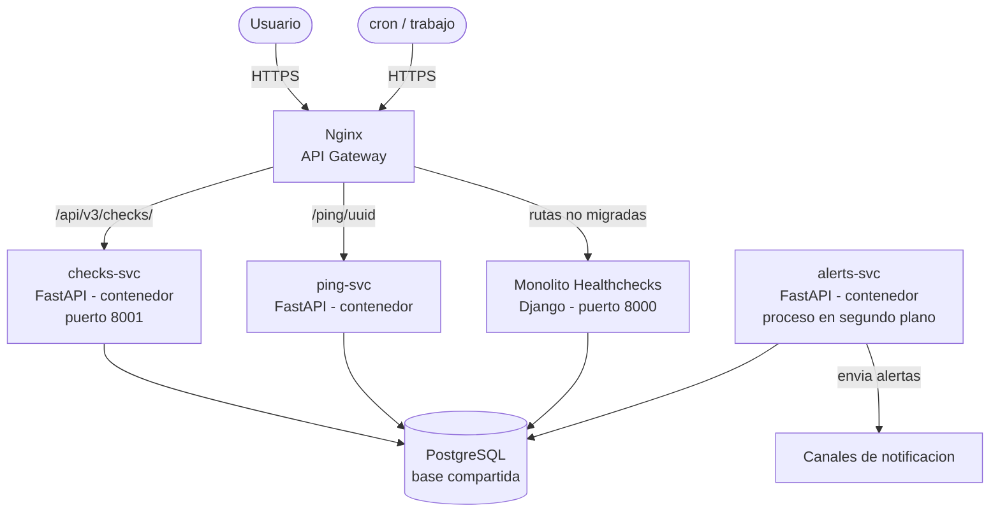
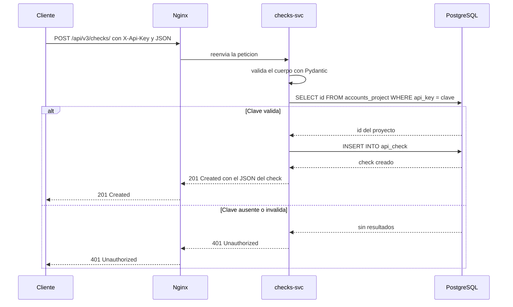
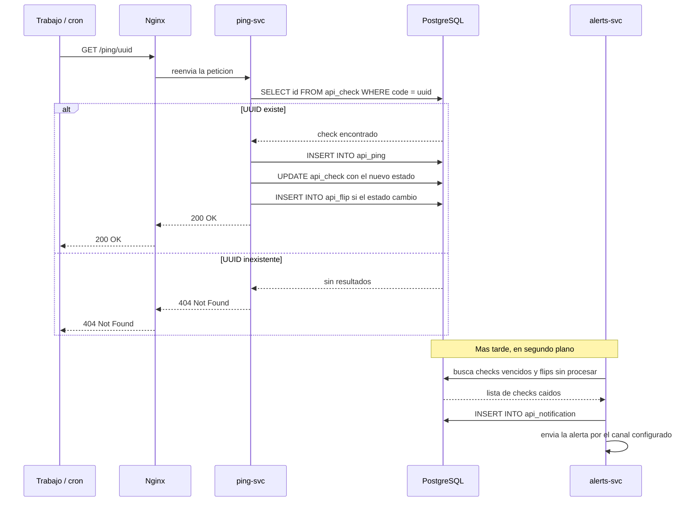

# Bloque I – A4: Modelo C4 y Diagramas de Secuencia

El modelo C4 describe el sistema en niveles de detalle crecientes. El **nivel 1** muestra el sistema como una sola caja y quiénes interactúan con él. El **nivel 2** abre esa caja y muestra las piezas desplegadas y cómo se comunican.

## F5-E5: C4 Nivel 1 — Contexto

**Quiénes participan:** el usuario administrador define qué tareas vigilar; los trabajos programados avisan cada vez que se ejecutan correctamente; y el sistema notifica hacia afuera cuando una tarea deja de avisar.

## F5-E6: C4 Nivel 2 — Contenedores

**Coherencia con lo desplegado:** cada caja corresponde a un contenedor real del `docker-compose`, salvo el monolito y PostgreSQL, que corren directamente en la VM. Nginx es el único punto de entrada expuesto; los servicios no publican puertos al exterior. alerts-svc no recibe tráfico HTTP porque es un proceso en segundo plano, por eso no cuelga de Nginx.

## F5-E7a: Secuencia — Crear un check, con camino de error 401

**Camino de error:** si la clave no existe en `accounts_project`, el servicio corta antes de tocar la tabla `api_check`. No se crea nada y el cliente recibe 401. La validación de autenticación ocurre siempre antes de cualquier escritura.

## F5-E7b: Secuencia — Recibir un ping y disparar una alerta, con camino de error 404

**Camino de error:** un UUID que no existe devuelve 404 y no genera ninguna fila, igual que en el monolito. **Interacción entre servicios:** ping-svc escribe el cambio de estado en `api_flip` y alerts-svc lo consume más tarde desde la base, sin llamarse entre sí. Ese es el acoplamiento por base compartida descrito en el ADR-009.
